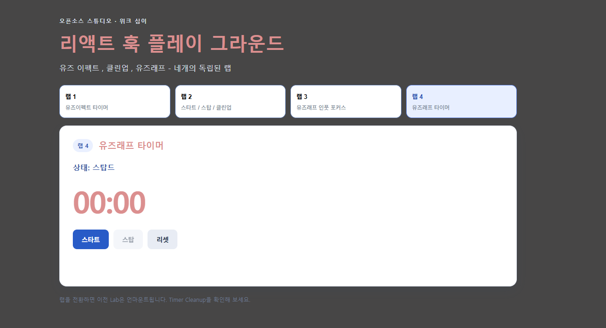
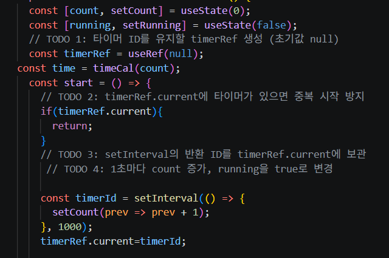
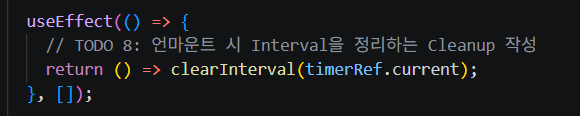
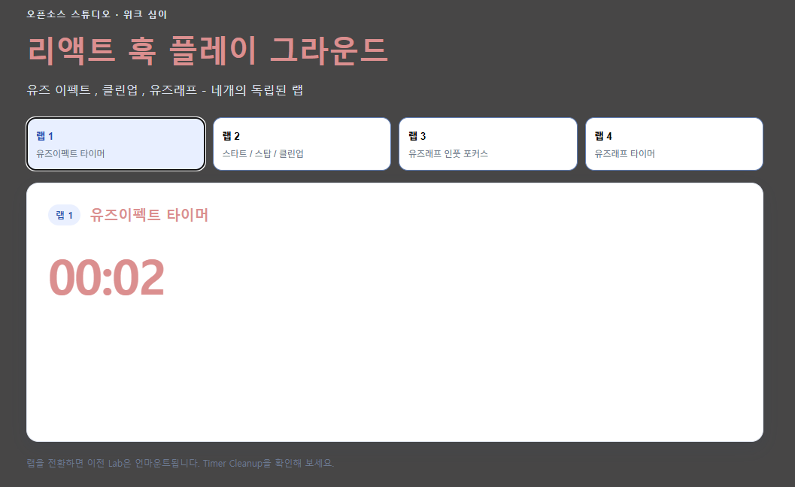
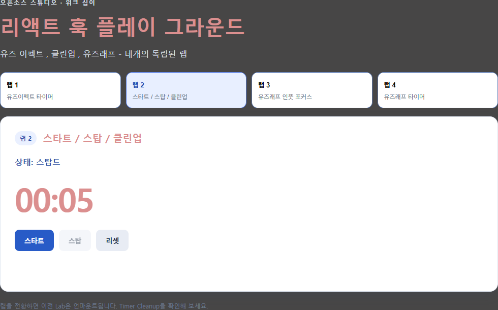
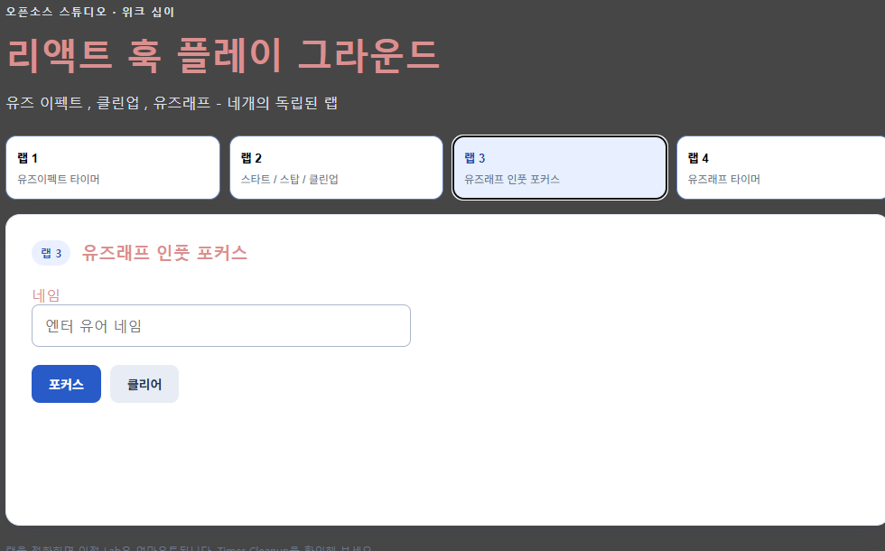
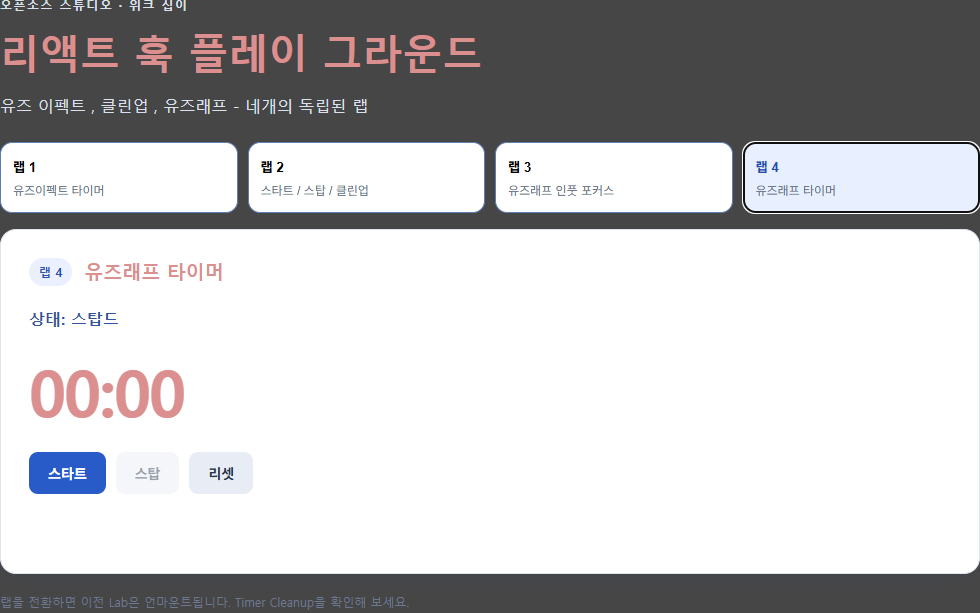

# Assignment 4-4. React Hooks Practice
---

## 1. Project Information:
- **과제 GitHub Repository**: https://github.com/2026-2-OSS/assign12-c01-22200698
- **개인 GitHub Repository**: https://github.com/juno5626/week12_starter_project
- **Vercel Deployment URL**: https://week12starterproject.vercel.app/

week 12 starter 코드를 바탕으로 4개의 랩에 Todo를 바탕으로 기능을 채워넣는 프로젝트 이다

---

## 2. Installation
- After clone 
- npm install
- npm start

---

## 3. Source Code Exploration
1. **src/components**:
   - 각 랩의 모든 기능을 하나의 jsx 파일로 관린한다. 
2. **useEffect vs useRef**:
   - useEffect는 상태 변화가ㅏ 있을떄마다 리랜더링 하지만 Ref는 그렇지 않다. 
   - useEffect는 함수를 호출하여 사용하지만 Ref는 직접 입력한다.
   - Lab4에서 변하는 값을 매번 랜더링하여 보여주어야 하기 때문에 count는 state 였고 그 뒤의 interval은 Ref였다.
3. **src/components/tumeCal.js**:
   - 분:초 형태로 표기하기 위해 문자열로 바꿔주는 함수를 만들어 적용하였다.

### 핵심 코드 분석 

- 위에서 말한 count와 timeId의 차이점이고 
- 언마운트 되면 잘 정리하도록 cleanUp 코드이다.

---

## 4. Lab Implementation
- LAB 1 구현 내용 및 실행 결과
   - setInterval로 숫자가 올라가도록 구현하였다
   
- LAB 2 구현 내용 및 실행 결과
   - running state로 stop , reset을 구현하였다.
   
- LAB 3 구현 내용 및 실행 결과
   - ref를 사용하여 속성을 연결하고 focuse와 clear를 구현하였다.
   
- LAB 4 구현 내용 및 실행 결과
   - count와 interval로 ref와 state의 비교를 하며 랩2를 구현하였다.
   

---

## 5. Lab Comparison (질문 4개에 대한 답)
- useEffect의 Dependency Array가 필요한 이유
   - 언제 다시 실행되는지를 정하는 부분이기 때문이다.
- Cleanup을 사용하지 않으면 발생할 수 있는 문제
   - 언마운트되어 사용하지 않는 브라우저의 타이머가 생길 수 있기 때문이다.
- useState와 useRef의 가장 중요한 차이
   - 리랜더링 유무, 값의 변경 방법 의 차이가 있다. 
- LAB 2와 LAB 4의 Timer 관리 방식 차이
   - 랩2는 state를 바꾸면 effect가 알아서 처리하는 방식이고, 랩4는 직접  만들고 따로 저장한다.

## 6. Customizing
- **수정한 파일명**: app.css, app.jsx
   - 모든 영어로 된 문자를 한국어로 바꾸었습니다. (위 파일 외에도 맍은 부분을 바꿨습니다)
- **CSS**: 본래 흰색 배경과 각 컴포넌트의 색상을 바꿔봤습니다. Css 변경이 가장 눈에 띄는 색상 변경을 선택하였습니다.
- **선택 구현 기능**: 분:초 로 표기되도록 하는 기능을 구현하였습니다.

---

## 7. Deployment
- **실제 접근 가능한 vercel URL**:
  - https://week12starterproject.vercel.app/

---
## 8.Weekly Review:
- 새롭게 배운 내용 3가지
   - useState의 사용법과 cleanup, dependancy 등 직접 값을 바꿔보면서 무엇인지 이해하였습니다.
   - useRef역시 직접 값을 바꿔보면서 어떻게 사용하는지 배웠습니다
   - 직접 js로 함수를 새로 만들어 적용하며 처음 사용해보는 함수들을 알게 되었습니다. 
- 어려웠던 점과 해결 방법
   - lab2 cleanup을 만들때 return 의 => 화살표로 만들지 않아 타이머가 즉시 꺼지는 문제가 있었습니다.
   - ref 연결을 잊어서 작동하지 않는 문제가 있었는데 강의자료로 찾아서 고쳤습니다.
   - 본래 분:초를 강각의 count를 따로 둬서 계산하여 보여주는 방식을 사용하려 했으나 ai의 도움을 받아 문자열로 변환하고 반환하여 문자열을 띄우는 방식으로 해결하였습니다 (이때 도움은 함수 사용법입니다)
- AI 활용 내용 및 느낀 점
   - 코드 에러시 문제점 찾기, 함수 사용법. 필요 개념 설명, 완성한 코드의 확인에 사용하였습니다.
   - **느낀점** : 처음에 강의실에서 배울떄는 굉장히 어렵게 느껴졌는데 막상 해보니 별거 아니였습니다. 오히려 리드미 작성하는게 더어렵네요....